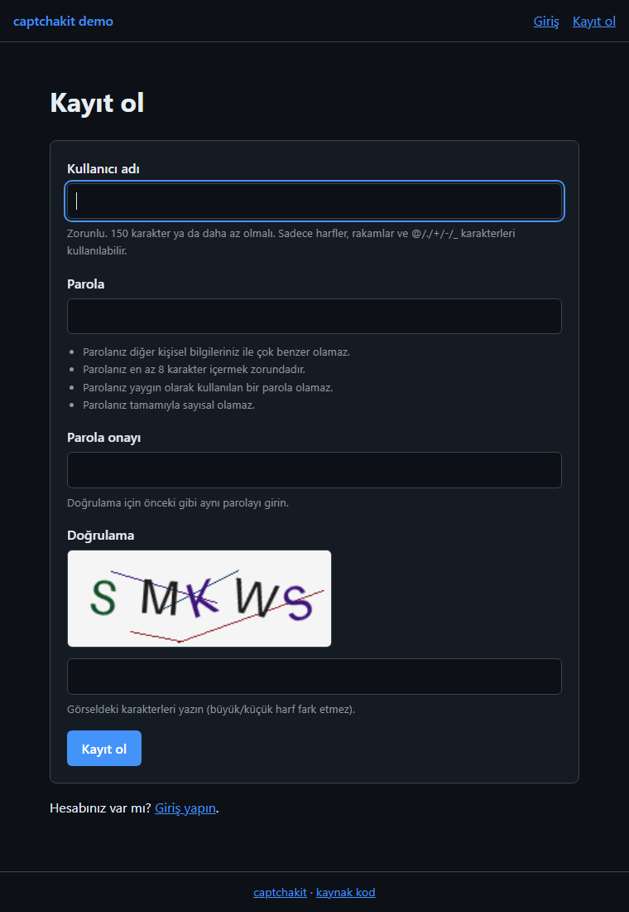
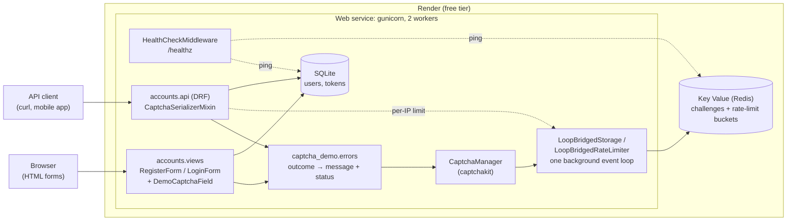
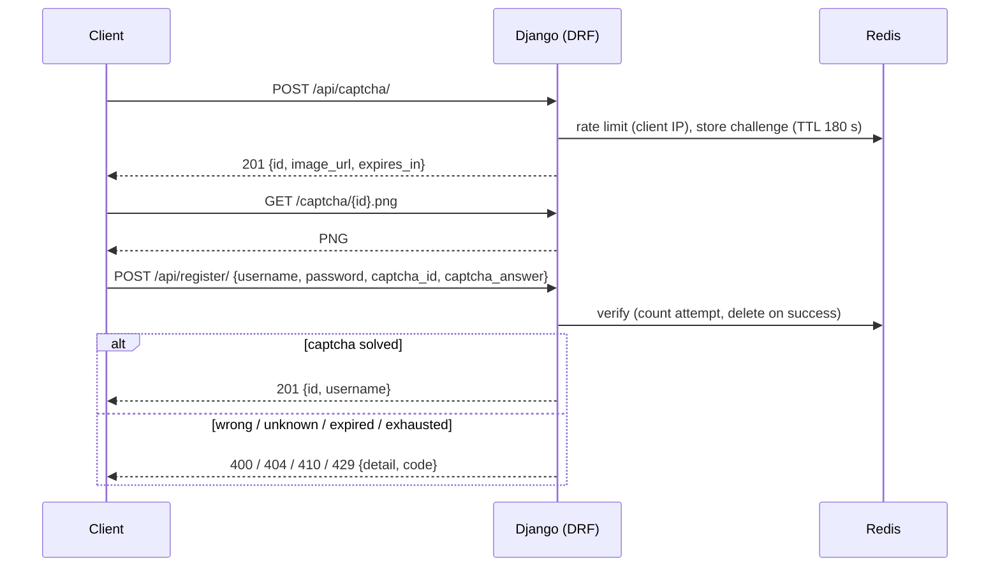

# captchakit-django-demo

[](https://github.com/akerem16/captchakit-django-demo/actions/workflows/ci.yml)

A small Django + Django REST Framework app that protects registration, login and a token
API with [captchakit](https://github.com/akerem16/captchakit), an async captcha library.
It is deployed on Render's free tier with Redis (Render Key Value).

**Live demo:** <https://captchakit-django-demo.onrender.com> (free tier: the first request
after 15 idle minutes takes about a minute while the service wakes up)



## Features

- **HTML pages** (Turkish UI): register, log in, log out (POST), profile. Each form shows
  a captcha image and verifies the answer on the server.
- **REST API** with DRF: issue a captcha, register, get a token, read the current user.
  Captcha failures map to proper status codes: `400` wrong or missing, `404` unknown or
  already used, `410` expired, `429` attempts exhausted or rate limited (with `Retry-After`).
- **OpenAPI 3** schema and Swagger UI at `/api/docs/` (drf-spectacular, served locally, no CDN).
- **Per-IP rate limit** on `POST /api/captcha/` (token bucket in Redis).
- **`/healthz`** checks the database and Redis for Render's health check.
- **CI on GitHub Actions:**
  - ruff, `ruff format --check`, `mypy --strict` (django-stubs, drf-stubs)
  - pytest with coverage of 100% (the gate is 85%)
  - `check --deploy` and an OpenAPI schema check
  - Redis integration tests against a real Redis
  - a Docker Compose smoke test

## Architecture



### API flow



## Design decisions

- **Redis for captcha state** ([ADR-001](docs/adr/001-redis.md)): 2 gunicorn workers must
  share challenges and rate-limit counters, and Redis expires keys by itself.
- **Event-loop bridge** ([`captcha_demo/loop_bridge.py`](captcha_demo/loop_bridge.py)):
  Django is sync and calls captchakit through `async_to_sync`, which opens and closes a new
  event loop per call. A `redis.asyncio` connection cannot be reused from another loop
  (`RuntimeError: Event loop is closed`, reproduced in CI against real Redis). All Redis
  calls therefore run on one long-lived loop per worker.
- **One error mapping** ([`captcha_demo/errors.py`](captcha_demo/errors.py)): forms and
  API use the same code, Turkish message and HTTP status for each captcha outcome.
- **Captcha first** ([`captcha_demo/drf.py`](captcha_demo/drf.py)): the DRF mixin verifies
  the captcha before any other field, so an unsolved request learns nothing (not even that
  a username is taken).
- **No password oracle on login:** Django's `AuthenticationForm` checks the password even
  when another field failed. `LoginForm` skips that check while the captcha is wrong, so a
  bot cannot test passwords without solving captchas.
- **Rate limiter kept off the manager:** captchakit's form field issues challenges with
  `key="global"`, so a limiter on the manager would throttle every page view together. The
  API applies its own limiter per client IP.
- **Upstream fix:** building this demo exposed a bug in captchakit's Django field: every
  instance of a form class shared one challenge. It is fixed in
  [captchakit#1](https://github.com/akerem16/captchakit/pull/1) (1.0.2), with a regression test.

## API

| Method | Path | Body | Success |
|---|---|---|---|
| POST | `/api/captcha/` | none | `201 {"id", "image_url", "expires_in"}` |
| POST | `/api/register/` | `username, password, captcha_id, captcha_answer` | `201 {"id", "username"}` |
| POST | `/api/token/` | `username, password, captcha_id, captcha_answer` | `200 {"token"}` |
| GET | `/api/me/` | header `Authorization: Token <token>` | `200 {"id", "username", "date_joined"}` |
| GET | `/api/schema/`, `/api/docs/` | none | OpenAPI 3 YAML, Swagger UI |

Captcha errors return `{"detail": "<message>", "code": "<code>"}`:

| Status | `code` |
|---|---|
| 400 | `captcha_required`, `captcha_invalid` |
| 404 | `captcha_not_found` |
| 410 | `captcha_expired` |
| 429 | `captcha_too_many_attempts`, `rate_limited` |

```bash
curl -X POST http://localhost:8000/api/captcha/
# open image_url, read the characters, then:
curl -X POST http://localhost:8000/api/register/ -H "Content-Type: application/json" \
  -d '{"username": "ayse", "password": "a-long-password", "captcha_id": "<id>", "captcha_answer": "<chars>"}'
```

## Run locally

### Docker Compose (web + Redis)

```bash
docker compose up --build
```

Open <http://localhost:8000>. Compose runs gunicorn with 2 workers against a Redis
container. SQLite is kept in a named volume.

### Without Docker

Requires [uv](https://docs.astral.sh/uv/). Without `REDIS_URL` the app stores captchas in
process memory, which is fine for a single dev server.

```bash
uv sync
cp .env.example .env   # optional; see the comments inside
DJANGO_DEBUG=true uv run python manage.py migrate
DJANGO_DEBUG=true uv run python manage.py runserver
```

### Checks

```bash
uv run ruff check . && uv run ruff format --check . && uv run mypy && uv run pytest
```

The Redis integration tests run only with a Redis server:
`TEST_REDIS_URL=redis://localhost:6379/0 uv run pytest -m redis --no-cov`.

## Configuration

| Variable | Default | Meaning |
|---|---|---|
| `DJANGO_SECRET_KEY` | none | Required unless `DJANGO_DEBUG=true` |
| `DJANGO_DEBUG` | `false` | Development mode |
| `DJANGO_ALLOWED_HOSTS` | `localhost,127.0.0.1` | Comma-separated; Render's host name is added automatically |
| `CSRF_TRUSTED_ORIGINS` | none | Comma-separated origins with scheme |
| `DATABASE_URL` | SQLite file | Any URL that dj-database-url understands |
| `REDIS_URL` | none | Redis for captchas and rate limits; memory if unset |
| `CAPTCHA_TTL` / `CAPTCHA_MAX_ATTEMPTS` | `180` / `3` | Captcha lifetime (s) and wrong answers allowed |
| `CAPTCHA_RATE_CAPACITY` / `CAPTCHA_RATE_REFILL` | `5` / `0.2` | API rate limit: burst size, tokens per second |
| `TRUSTED_PROXY_COUNT` | `0` | Reverse proxies in front of the app (Render: `3`, Cloudflare + Render) |

## Deploy on Render

`render.yaml` is a Render Blueprint: a free Python web service plus a free Key Value
instance that is closed to the internet. Step-by-step instructions are in
[docs/deploy-render.md](docs/deploy-render.md).

Free-tier caveats:

- **The web service sleeps** after 15 minutes without traffic and needs about a minute to wake up.
- **Key Value is in memory only**, so a restart clears captchas and rate-limit buckets.
- **The disk is ephemeral**, so the SQLite database (and the registered users) resets on
  every deploy or restart. Free Render Postgres is not used because it expires after 30 days.

## Project layout

```
config/          settings (from environment variables), urls, wsgi, asgi
captcha_demo/    captcha manager, loop bridge, error mapping, form field, DRF mixin, /healthz
accounts/        HTML forms and views, DRF API, templates
templates/       base layout and home page
tests/           pytest suite (MemoryStorage) + Redis integration tests
docs/            ADR-001, Render guide, screenshot
```

## License

MIT
